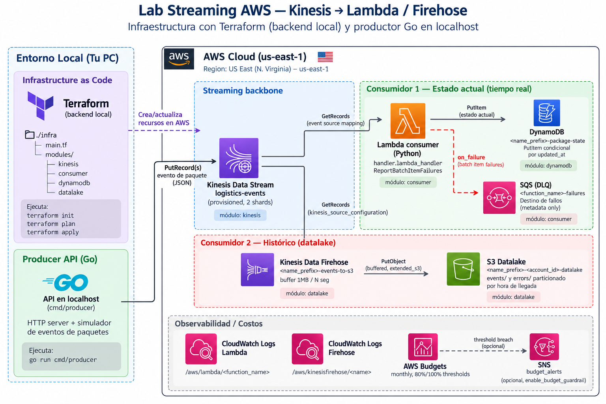

# Lab Sesión 7 — Data Streaming en AWS

## La historia: una empresa de paquetería con una pregunta imposible

Una empresa de paquetería registra cada movimiento de un paquete: creado, en
tránsito, en reparto, entregado. Cada evento llega como un mensaje
independiente, a cualquier hora, desde cualquier origen. Y el negocio hace dos
preguntas que, en apariencia, piden lo mismo pero no se responden con el mismo
dato:

- **"¿Dónde está el paquete PKG-001 ahora mismo?"** — una sola respuesta,
  siempre actualizada, consultable en milisegundos.
- **"¿Qué pasó con todos los paquetes durante octubre?"** — el historial
  completo, para auditoría, analítica o reentrenar un modelo.

Guardar solo el estado actual destruye el historial. Guardar solo el
historial obliga a recalcular el estado actual en cada consulta. La solución
de este lab es no elegir: **un mismo flujo de eventos alimenta dos destinos
distintos, cada uno optimizado para su pregunta.**

```text
Go API → Kinesis (2 shards) ─┬→ Lambda (Python) → DynamoDB   = ¿cuál es el estado ACTUAL?
                             └→ Firehose → S3 (Data Lake)    = ¿qué EVENTOS ocurrieron?
```



*(Diagrama fuente en [docs/architecture/architecture.dot](docs/architecture/architecture.dot);
regenera el PNG con `dot -Tpng docs/architecture/architecture.dot -o docs/architecture/architecture.png`.)*

Diseño: [docs/specs/2026-10-06-streaming-lab-design.md](docs/specs/2026-10-06-streaming-lab-design.md) ·
Spec funcional: [docs/specs/spec_sesion_7_streaming_aws_laboratorio_refinado.md](docs/specs/spec_sesion_7_streaming_aws_laboratorio_refinado.md) ·
ADR: [docs/internal/adr/0001-streaming-architecture.md](docs/internal/adr/0001-streaming-architecture.md)

## Un mismo pipeline, dos lenguajes — y por qué

El lab usa deliberadamente dos lenguajes distintos en dos puntos distintos del
flujo. No es inconsistencia: cada uno encaja con el trabajo que tiene al lado.

- **Go en el producer:** es un servidor HTTP que debe aceptar ráfagas de
  eventos (`POST /events`, `POST /events/batch`) y convertirlas en llamadas
  `PutRecord`/`PutRecords` contra Kinesis con baja latencia. Go compila a un
  único binario sin runtime ni dependencias que instalar en la máquina del
  instructor, y su concurrencia nativa (goroutines) encaja de forma natural
  con un servidor que atiende múltiples solicitudes a la vez. Para la pieza
  que *empuja* datos a alta velocidad, eso importa.
- **Python en la Lambda consumidora:** aquí el trabajo es distinto — no
  servir tráfico, sino reaccionar a lotes de registros que Kinesis ya
  entregó, parsear JSON, validar contra el contrato y escribir en DynamoDB
  con una condición. Python es el lenguaje con el soporte más directo y
  simple en AWS Lambda para este tipo de tarea: el handler usa solo la
  librería estándar más `boto3` (ya presente en el runtime gestionado), sin
  dependencias extra que empaquetar. Para transformar y validar datos evento
  por evento, la simplicidad pesa más que el rendimiento bruto.

En otras palabras: **Go donde hay que aguantar carga de entrada concurrente
sin fricción de despliegue; Python donde hay que transformar datos con el
mínimo de piezas móviles.** Es también una decisión didáctica — mostrar que
un mismo pipeline de streaming no obliga a un solo lenguaje — pero la elección
de *cuál lenguaje en qué punto* no es arbitraria.

## Requisitos

1. Clona el repositorio:

   ```bash
   git clone https://github.com/Merlin2098/lab_streaming_aws.git
   cd lab_streaming_aws
   ```
2. AWS CLI, Terraform ≥ 1.6, Go ≥ 1.23, `uv`, Git Bash y una access key de AWS. Copia `.env.credentials.example` a `.env.credentials`, pon tus claves y cárgalo con `set -a; source .env.credentials; set +a` en cada terminal (no hace falta un perfil de AWS).

## 1. Desplegar (instructor)

```bash
cd infra
terraform init
terraform plan
terraform apply          # crea recursos de pago: ~USD 0.03/h por los 2 shards
```

Todas las variables tienen valor por defecto: no necesitas `terraform.tfvars`. Para ver el flujo minuto a minuto en clase, crea `infra/terraform.tfvars` (copia `terraform.tfvars.example`) con `datalake_partition_granularity = "minute"` (solo demo; en producción usa `hour`). Detalles en [docs/deploy-guide.md](docs/deploy-guide.md).

## 2. Levantar el producer

Guía completa de la API (cómo llega a AWS sin túnel, referencia, generador de eventos y demo en tiempo real): [docs/producer-api.md](docs/producer-api.md).

Con `EMIT_INTERVAL=25s` (ya viene en `.env.credentials.example`) el producer **emite solo un lote de eventos simulados cada 25 s**, sin enviar nada a mano: así se ve el flujo en vivo en DynamoDB y en el Data Lake. Detalles en esa guía.

```bash
cd producer && go build -o bin/producer.exe ./cmd/producer && cd ..
set -a; source .env.credentials; set +a
STREAM_NAME=$(terraform -chdir=infra output -raw stream_name) ./producer/bin/producer.exe
```

## 3. Demo (pasos del spec)

En otra terminal (la misma cuenta y región que el despliegue). Variables útiles:

```bash
set -a; source .env.credentials; set +a      # credenciales y región para los comandos aws
TABLE=$(terraform -chdir=infra output -raw table_name)
BUCKET=$(terraform -chdir=infra output -raw datalake_bucket_name)
```

1. **Problema:** necesitamos el estado actual y, a la vez, el historial completo.
2. **Producer vivo:** `curl -s localhost:8080/health`
3. **Primer evento:** `curl -s -X POST localhost:8080/events -d @producer/examples/01_created.json`
   La respuesta trae `shard_id` y `sequence_number`: producer, record, partition key (`package_id`), shard y sequence number.
4. **Kinesis:** `aws kinesis list-shards --stream-name logistics-events` (2 shards).
5. **Lambda → DynamoDB:** `aws dynamodb get-item --table-name $TABLE --key '{"package_id":{"S":"PKG-001"}}'` → `CREATED`.
   Espera 5-10 s tras el POST (ventana de batching de 5 s y posible arranque en frío); si sale `{}`, repite.
   Logs: `MSYS_NO_PATHCONV=1 aws logs tail $(terraform -chdir=infra output -raw consumer_log_group_name) --since 5m` (en Git Bash, sin `MSYS_NO_PATHCONV=1` la ruta `/aws/lambda/…` se convierte en ruta de Windows)
6. **Segundo evento:** `curl -s -X POST localhost:8080/events -d @producer/examples/02_in_transit.json` y repite el `get-item` → `IN_TRANSIT`. El valor anterior se **actualiza**.
7. **Firehose:** el mismo evento sigue hacia S3 (buffer de 60 s).
8. **Histórico:** `aws s3 ls s3://$BUCKET/events/ --recursive` y
   `aws s3 cp s3://$BUCKET/<key> -` → aparecen `CREATED` **e** `IN_TRANSIT`.
   DynamoDB = estado actual · S3 = historial.
9. **Varios paquetes:** `curl -s -X POST localhost:8080/events/batch -d @producer/examples/batch.json`
   (usa `PutRecords`; la respuesta trae el resultado por registro, `207` si alguno falla).
10. **Data Lake:** observa las particiones `year=/month=/day=/hour=[/minute=]` en S3. Glue/Athena se explica conceptualmente.

Para repetir la demo con el mismo paquete usa otro `package_id` (o `aws dynamodb delete-item`): un evento con `timestamp` igual o menor al guardado se ignora a propósito.

## Notas para la clase

- **Partition key:** `package_id` es una decisión didáctica; en producción puede crear shards calientes.
- **Orden y estado:** DynamoDB solo escribe si el evento es más nuevo (`updated_at`); un evento viejo se ignora sin error.
- **Fallos:** la Lambda reporta solo los registros malos (`ReportBatchItemFailures`); tras los reintentos van a una cola SQS. Esa cola solo guarda metadatos (shard y sequence numbers): el evento se recupera del stream mientras dure la retención (24 h).
- **Particiones S3:** usan la hora de llegada a Firehose, no la del evento. `minute` es solo para la demo.
- **Seguridad:** el producer escucha solo en `127.0.0.1` (sin autenticación). Usa las credenciales por defecto del SDK; **en producción se recomienda un rol dedicado con `AssumeRole`**.
- **Kafka/MSK:** mismo patrón (Producer → Topic → Partition → Consumer) frente a (Producer → Stream → Shard → Consumer); solo conceptual.

## 4. Pruebas

```bash
# Unitarias y estáticas (sin AWS)
uv run python scripts/testing/run_pytest.py tests/test_event_contract.py tests/test_consumer_handler.py tests/test_contract_parity.py tests/test_terraform_guardrails.py
(cd producer && go test ./...)

# Contra el lab desplegado (usa .env.credentials); sin despliegue se saltan solas
uv run python scripts/testing/run_cloud_tests.py tests/aws -m cloud -v
```

## 5. Limpieza (obligatoria al terminar)

```bash
terraform -chdir=infra destroy    # requiere aprobación del instructor
```
